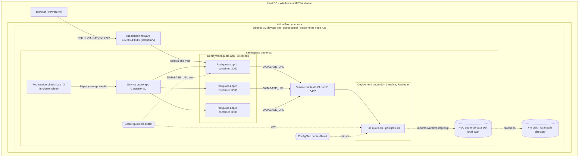

# Lab 52 – Architecture notes

Lab 42 results (deployment, health checks, Pod replacement, readiness failure/recovery, liveness extension):
[../42-kubernetes/verification.md](../42-kubernetes/verification.md)

## Database checks
PersistentVolumeClaim:
```
quote-db-data   Bound   pvc-8440a2be-5fc1-46bb-9742-21ed16cd34e9   1Gi   RWO   local-path
```
Quote inserted through the app (`POST /quotes`) and read back (`GET /`):
```
Marker: res509-1794903844
before:  <div>res509-1794903844</div>
```
Database Pod replaced with `kubectl rollout restart deployment/quote-db`, same PVC:
```
old Pod: quote-db-796c9c9d49-bt8cl
new Pod: quote-db-5c9c766968-vn2v8
after:   <div>res509-1794903844</div>
```

## Diagram
Boxes = "runs inside". Solid arrows = traffic. Dotted arrows = configuration and storage.



The port-forward reaches a single app Pod and does not show Service load balancing; the in-cluster path through the Service was verified separately in Lab 42.

## Shared kernel
The three app containers and the PostgreSQL container all share the Ubuntu VM's guest kernel: they are isolated processes, not separate machines. The VM boundary comes from the VirtualBox hypervisor, which gives the VM its own kernel separate from the Windows host; Kubernetes only manages workloads inside that VM.

## Persistence boundary
App Pods can be replaced freely because they keep no state. The quote survived the database Pod replacement because PostgreSQL's data lives in the PVC (a local-path directory on the VM disk), which the new Pod mounted again. But all replicas and the local-path storage sit on one VM, so losing the VM or its disk would lose both the application and the data: there is no replication and no backup.

## Main limitation and next action
- Limitation: single node with local-path storage and no backup.
- Next action: add a regular `pg_dump` backup stored outside the VM, then look at multi-node and replicated storage for Lab 62.
- Environment note: the IUT network intercepts HTTPS (Fortinet), so k3s was installed from release files downloaded on the host and verified with `sha256sum`, and the app and PostgreSQL images were imported from the local Docker store.
